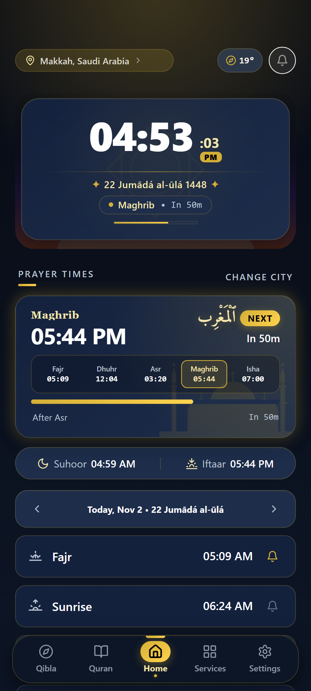
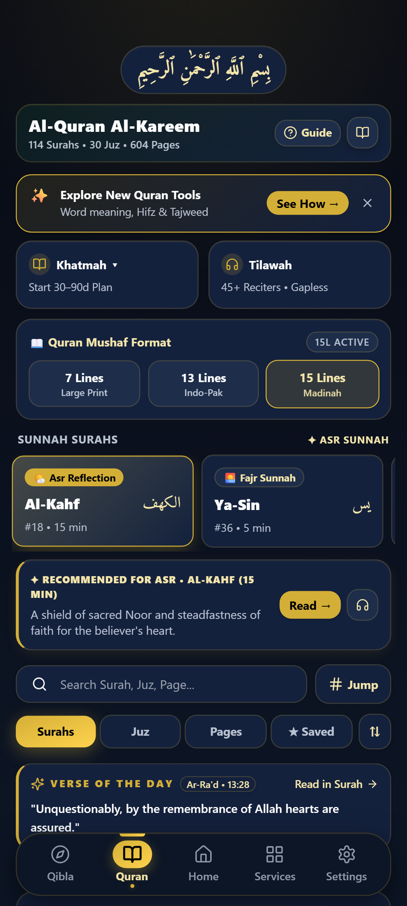
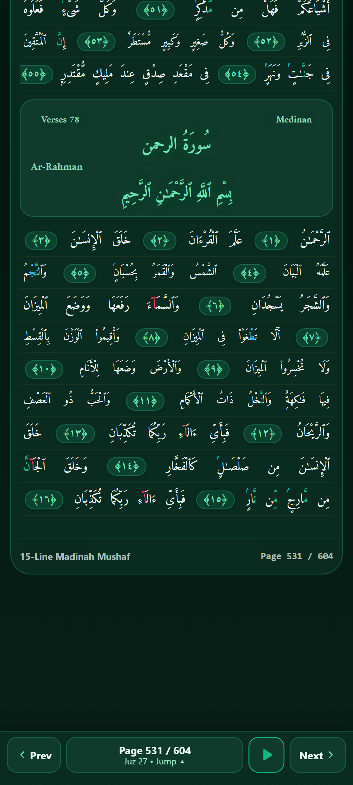
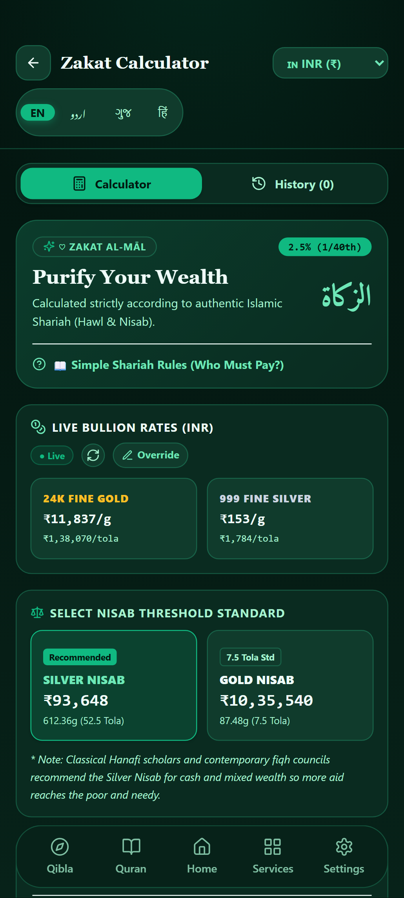
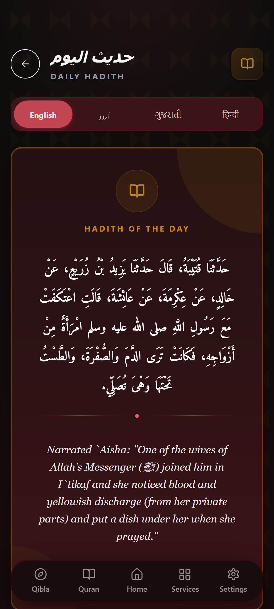
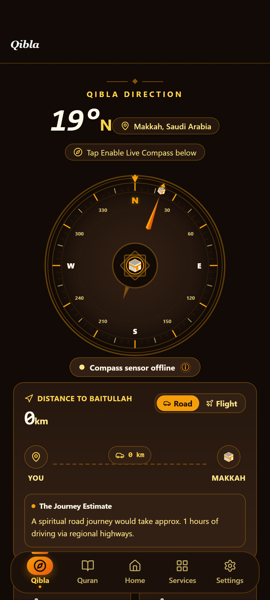
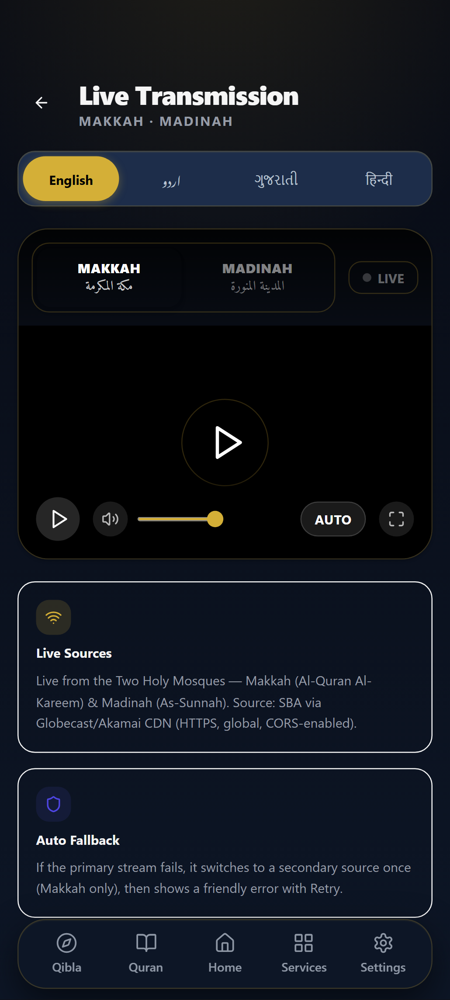
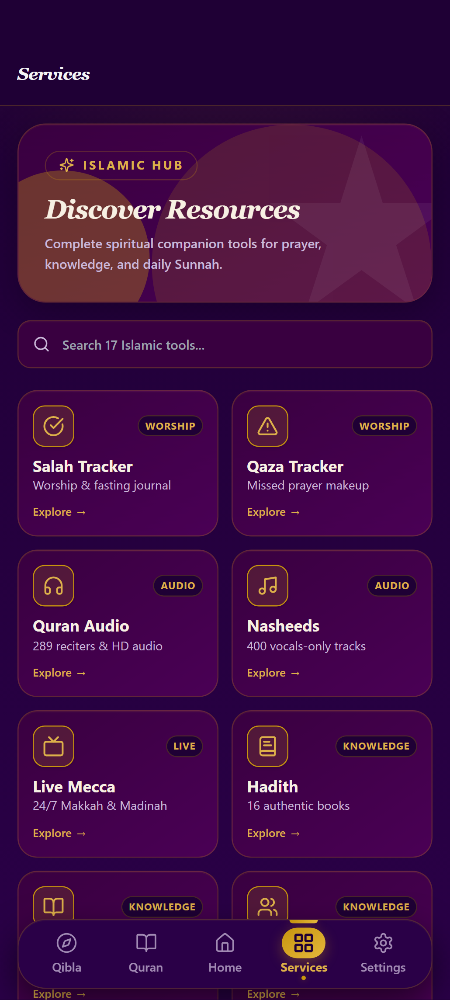
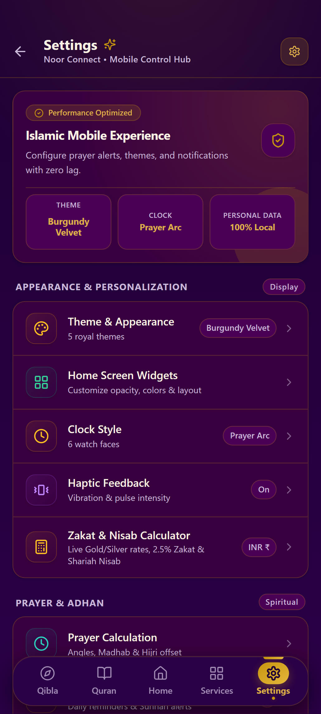

<div align="center">


# 🌙 Siraj (`سِـرَاج`)
### Your Sacred, Privacy-First Islamic Companion
**Version 3.0.0 • Android (`com.siraj.app`) & Web • 100% Offline Fallback • Zero Trackers**

[](LICENSE)
[](https://github.com/Ahmadnedariya786/siraj/releases/latest)
[](https://github.com/Ahmadnedariya786/siraj)
[](https://github.com/Ahmadnedariya786/siraj/security/code-scanning)
[](metadata/com.siraj.app.yml)
[](#-privacy-first-architecture)
[](https://nocopyrightnasheed.com/)

<p align="center">
  <a href="https://github.com/Ahmadnedariya786/siraj/releases/download/nightly/siraj-nightly.apk">
    
  </a>
  &nbsp;&nbsp;
  <a href="https://github.com/Ahmadnedariya786/siraj/releases/download/nightly/Siraj-v3.0.0.apk">
    
  </a>
</p>

</div>

---

## 📖 Table of Contents

- [🌙 Overview](#-overview)
- [📲 Direct Downloads & Installation](#-direct-downloads--installation)
- [📱 Visual Showcase (v3.0.0 Screenshots)](#-visual-showcase-v300-screenshots)
- [🌟 Flagship Subsystems & Capabilities](#-flagship-subsystems--capabilities)
  - [🕌 Deeniyat-Grade 4-Season Prayer Engine](#-deeniyat-grade-4-season-prayer-engine)
  - [🎨 8 Royal Dark-Luxury Themes & 5 Living Logo Editions](#-8-royal-dark-luxury-themes--5-living-logo-editions)
  - [📱 7 Native Android Home Screen Widgets](#-7-native-android-home-screen-widgets)
  - [🧭 True-North Qibla Finder & Nearby Mosques](#-true-north-qibla-finder--nearby-mosques)
  - [⚖️ Single-Source Qaza Tracker & Fidya Ledger](#-single-source-qaza-tracker--fidya-ledger)
  - [📖 Noble Quran, Audio Suite & Tafsir Explorer](#-noble-quran-audio-suite--tafsir-explorer)
  - [📚 Cloud E-Books Library (5-Volume Tafseer Anwar-ul-Bayan)](#-cloud-e-books-library-5-volume-tafseer-anwar-ul-bayan)
  - [💰 Multi-Currency Shariah Zakat & Nisab Calculator](#-multi-currency-shariah-zakat--nisab-calculator)
  - [🎬 Siraj Clip Studio](#-siraj-clip-studio)
- [🛡️ Privacy-First Architecture & Security Lock](#-privacy-first-architecture--security-lock)
- [🛠️ Building & Development](#-building--development)
- [📜 License & Ummah Dedication](#-license--ummah-dedication)

---

## 🌙 Overview

**Siraj** (`سِـرَاج`, `com.siraj.app`) is a luxury, privacy-first Islamic digital companion crafted for the global Ummah. Built with modern web standards and native Android hardware integrations, it offers **zero UI friction, zero ads, zero trackers, and complete offline capability**.

Unlike conventional commercial Islamic mobile apps that monetize spiritual habits or sell user geolocation data to advertising brokers, Siraj enforces a strict **Zero-Data-Leak guarantee**:
- **Personal Data Never Leaves Your Device**: Prayer times, Quran progress, bookmarks, notes, Tasbeeh sessions, and Zakat records remain in local, encrypted on-device storage.
- **Offline-First Astronomy**: Astronomical prayer calculations and Qibla bearings run 100% locally without requiring internet connectivity.
- **Stealth Owner Protocol**: Protected developer tools and diagnostics remain invisible to normal users, ensuring an uncompromised spiritual environment.

---

## 📲 Direct Downloads & Installation

| Asset | Target | Size | Direct Link | Checksum |
| :--- | :--- | :--- | :--- | :--- |
| **siraj-nightly.apk** | Android 8.0+ (ARM64 / ARMv7 / x86_64) | ~14 MB | [**Direct Download**](https://github.com/Ahmadnedariya786/siraj/releases/download/nightly/siraj-nightly.apk) | [SHA-256](https://github.com/Ahmadnedariya786/siraj/releases/download/nightly/siraj-nightly.apk.sha256) |
| **Siraj-v3.0.0.apk** | Official Stable Release Asset | ~14 MB | [**Direct Download**](https://github.com/Ahmadnedariya786/siraj/releases/download/nightly/Siraj-v3.0.0.apk) | [SHA-256](https://github.com/Ahmadnedariya786/siraj/releases/download/nightly/Siraj-v3.0.0.apk.sha256) |
| **version.json** | Fast In-App Auto-Updater Manifest | <1 KB | [View Manifest](https://github.com/Ahmadnedariya786/siraj/releases/download/nightly/version.json) | — |

### Installing the APK on Android
1. Tap **[Download Latest APK](https://github.com/Ahmadnedariya786/siraj/releases/download/nightly/siraj-nightly.apk)** directly on your Android phone.
2. When prompted by your browser, select **Download anyway** and tap **Install**.
3. If this is your first manual APK install, enable *"Allow from this source"* in Android Settings.
4. Siraj includes an in-app turbo 4-thread parallel downloader: future updates can be checked and installed in 1 tap from `Settings > About Siraj` or the Home update banner.

---

## 📱 Visual Showcase (v3.0.0 Screenshots)

Captured directly from the live v3.0.0 production build across the **Royal Themes**:

<table>
  <tr>
    <td align="center" width="33%">
      
      <br/>
      <b>Home Dashboard</b>
      <br/>
      <sub>Oxford Gold • Prayer Countdown & Clocks</sub>
    </td>
    <td align="center" width="33%">
      
      <br/>
      <b>Quran Hub & Sunnah</b>
      <br/>
      <sub>Madinah Emerald • 4-Tab Hub & Quick Surahs</sub>
    </td>
    <td align="center" width="33%">
      
      <br/>
      <b>Tajweed Mushaf</b>
      <br/>
      <sub>15-Line Uthmani DP Page Layout</sub>
    </td>
  </tr>
  <tr>
    <td align="center" width="33%">
      
      <br/>
      <b>Zakat Calculator</b>
      <br/>
      <sub>Kiswah Noir • Multi-Currency Nisab Assessment</sub>
    </td>
    <td align="center" width="33%">
      
      <br/>
      <b>Tafsir & Hadith Hub</b>
      <br/>
      <sub>Istanbul Sapphire • 25+ Authentic Commentaries</sub>
    </td>
    <td align="center" width="33%">
      
      <br/>
      <b>True-North Qibla</b>
      <br/>
      <sub>Imperial Violet • Earth Globe & Sun Azimuth</sub>
    </td>
  </tr>
  <tr>
    <td align="center" width="33%">
      
      <br/>
      <b>Live Haramain Streams</b>
      <br/>
      <sub>Burgundy Velvet • 24/7 Makkah & Madinah</sub>
    </td>
    <td align="center" width="33%">
      
      <br/>
      <b>Services Hub</b>
      <br/>
      <sub>Desert Scroll • 17 Integrated Spiritual Tools</sub>
    </td>
    <td align="center" width="33%">
      
      <br/>
      <b>Settings & Theme Engine</b>
      <br/>
      <sub>8 Royal Themes • 5 Living Logos • Stealth Vault</sub>
    </td>
  </tr>
</table>

---

## 🌟 Flagship Subsystems & Capabilities

### 🕌 Deeniyat-Grade 4-Season Prayer Engine
- **Automatic Regional Presets**: Instant configuration for `Karachi 18°/18°`, `Hanafi 2×` shadow ratio (with dual Shafi'i preview), `Dhuhr +5m Zawaal` ihtiyat buffer, `Maghrib +3m Ihtiyat`, and `India Hilal -1d` regional calendar synchronization.
- **Start & End (Qaza) Times**: Precise calculation of prayer expiration windows (e.g., `Asr Ends = Sunset`), warning users in advance of impending Qaza.
- **Live Red Makruh Waqt System**: Instant, real-time warning alerts for the 3 authentic prohibited prayer intervals:
  1. *Sunrise Window* (`Sunrise` to `Sunrise + 15m`)
  2. *Zawaal Window* (`Dhuhr - 10m` to `Dhuhr`)
  3. *Sunset Window* (`Maghrib - 15m` to `Maghrib`)
  Warnings auto-dismiss at `:00s` the second the window concludes.
- **Sunnah & Fasting Windows**: Live tracking of `Khatm Sehri`, `Ishraaq`, `Chaasht (Duha)`, and `Tahajjud (Last 1/6th of Night)`.
- **Monthly Timetable Generator**: Generates beautiful, high-resolution printable timetables and shareable mosque cards.
- **Auto-DND Silent Mode**: Automatically mutes the phone during Jamaat prayer windows to prevent disruptions.

### 🎨 8 Royal Dark-Luxury Themes & 5 Living Logo Editions
- **8 Exquisite Themes**: `Kiswah Noir`, `Istanbul Sapphire`, `Oxford Gold`, `Imperial Violet`, `Burgundy Velvet`, `Desert Scroll`, `Madinah Emerald`, and `Persian Indigo`—all enforced with 17 root CSS tokens and plain CSS fallbacks.
- **8 Adaptive Navigation Bars**: Floating glass, segmented pill, and luxury dock styles with Navbar Style Override settings.
- **5 Theme-Adaptive Living Logo Editions**:
  1. **Edition 1 — Luminous Sanctuary Arch (Flagship)**: Layered translucent pointed Islamic arch with glowing dome and radiant crescent & star.
  2. **Edition 2 — Kaaba Orbit**: Minimal isometric Kaaba surrounded by a luminous geometric Tawaf orbital ring and 3 celestial light orbs.
  3. **Edition 3 — Prayer Niche Arch**: Layered dual-arch silhouette with muqarnas stepped fringe accents and central crescent.
  4. **Edition 4 — Dawn Horizon**: Spherical Fajr/Maghrib dome rising over crisp geometric horizontal reflection lines.
  5. **Edition 5 — Siraj Star Emblem**: Luminous central lamp (Fanous) framed within an 8-point Rub el Hizb architectural star.
  *(All logos use pure layered SVG `<linearGradient>` and `<radialGradient>` without any performance-degrading `backdrop-filter` or SVG `drop-shadow`).*

### 📱 7 Native Android Home Screen Widgets
Fully native Android app widgets optimized for direct-boot awareness, battery conservation, and zero UI stutter:
1. **Siraj • Circular Progress-Arc Clock (`2×2` / `3×2`)**: Canvas-rendered circular prayer arc with native `TextClock`.
2. **Siraj • 6-Prayer Compact Strip (`4×1`)**: Ultra-compact 1-row prayer launcher highlighting the active/next prayer.
3. **Siraj • Next Prayer (`4×2`)**: High-contrast card with Qaza End Time countdown and quick-refresh button.
4. **Siraj • Daily Ayah (`4×2`)**: Localized Arabic Ayah of the day with English/Urdu translation.
5. **Siraj • Daily Hadith (`4×2`)**: Daily Prophetic guidance with narrator, grade, and source citation.
6. **Siraj • Quran Progress & Streak (`4×2`)**: Real-time tracking of daily pages, active streak, and Khatmah percentage.
7. **Siraj • Live Interactive Tasbeeh (`2×2`)**: Direct tap-to-increment dhikr counter with native haptic pulses.

### 🧭 True-North Qibla Finder & Nearby Mosques
- **Sensor Fusion**: Combines accelerometer, magnetometer, and gyroscope readings with NOAA solar azimuth cross-validation and shortest-arc angular smoothing.
- **Great-Circle Earth Globe**: 3D orthographic globe projection displaying true great-circle geodesic curves, flight distance, and heading to Makkah.
- **Auto Nearby Mosque Discovery**: Multi-tier zero-key parallel discovery combining Photon, Overpass, and Nominatim endpoints.
- **Masjid Management**: Add local masjids, configure custom 6-prayer Jamaat schedules, and pin your home masjid to the dashboard.

### ⚖️ Single-Source Qaza Tracker & Fidya Ledger
- **Bidirectional Ledger Synchronization**: Dated prayer logs and aggregate counters stay in 100% sync.
- **Makruh Waqt Guard**: Warns users against making up missed prayers during active Makruh intervals.
- **5-Second Toast Undo**: Immediate revert functionality prevents accidental taps.
- **Qaza-e-Umri Estimator & Daily Finish Planner**: Calculates remaining makeup prayers and projects estimated completion dates.
- **Fidya & Kaffarah Calculator**: Accurate Shariah calculations based on prevailing local wheat and barley market rates.

### 📖 Noble Quran, Audio Suite & Tafsir Explorer
- **Balanced Knuth-Plass Mushaf**: Uniform font scaling across `7L`, `13L`, and `15L` traditional page layouts with anti-orphan word distribution.
- **Synchronous In-Memory Cache**: 6-page memory prefetch sliding window ($N-2$ to $N+4$) delivers instantaneous page flips.
- **47 Authentic Reciters**: Background continuous audio playback with verse-by-verse highlighting.
- **25+ Commentary Editions**: Authentic offline commentaries in English, Urdu, Arabic, Bengali, and French.

### 📚 Cloud E-Books Library (5-Volume Tafseer Anwar-ul-Bayan)
- **Multi-Threaded CDN Downloader**: Download and read the complete 5-Volume *Tafseer Anwar-ul-Bayan* in high fidelity.
- **Offline Byte Cache**: Download once, read forever without internet connectivity.

### 💰 Multi-Currency Shariah Zakat & Nisab Calculator
- **Gold & Silver Nisab Valuation**: Live and manual entry for 24K, 22K, 21K, and 18K gold and silver rates across 30+ global currencies.
- **Comprehensive Asset Coverage**: Cash, bank balances, trade inventory, shares, mutual funds, gold/silver jewelry, and agricultural produce.
- **Official Assessment Certificate**: Instant PDF generation with verification stamps for record-keeping.

### 🎬 Siraj Clip Studio
- **Islamic Reel & Social Card Generator**: Turn Quranic verses and authentic Hadith into viral video reels and social cards.
- **Theme-Synchronized Typography**: Uses the app's active color palette with high-contrast calligraphic rendering.
- **Native Android MediaStore Integration**: Exports directly to device gallery (`Movies/Siraj` and `Pictures/Siraj`).

---

## 🛡️ Privacy-First Architecture & Security Lock

1. **Zero-Tracking Guarantee**:
   - Zero telemetry SDKs, zero third-party trackers, zero Google Analytics.
   - All personal data is stored exclusively in IndexedDB and private SQLite databases on your device.
2. **Stealth 5-Tap Owner Security Vault**:
   - Access developer tools and diagnostics by tapping the **Version 3.0.0** badge 5 times within 3 seconds.
   - Protected by salted SHA-256 zero-knowledge cryptographic verification.
   - Zero plain-text key storage in source code or Git history.
3. **Deep X-Ray Diagnostics Engine**:
   - Built-in 8-point automated health scan covering storage integrity, notification channels, exact alarms, widget sync, and sensors.

---

## 🛠️ Building & Development

### Prerequisites
- Node.js `20.x` or later
- JDK `17` (Temurin recommended)
- Android SDK (`platforms;android-34` or `36`, `build-tools;36.0.0`)
- Gradle `8.x`

### Quick Start
```bash
# 1. Clone repository
git clone https://github.com/Ahmadnedariya786/siraj.git
cd siraj

# 2. Install dependencies
npm ci

# 3. Synchronous typecheck and lint
npm run typecheck
npm run lint

# 4. Build web bundle
npm run build

# 5. Sync native Android project
npx cap sync android

# 6. Build debug APK
cd android
./gradlew assembleDebug
```

---

## 📜 License & Ummah Dedication

Siraj is open-source software licensed under the **GNU General Public License v3.0** (`GPL-3.0-or-later`).

```
Siraj — Your Sacred Islamic Companion
Copyright (C) 2026 Ahmad Nedariya and Siraj Contributors.

This program is free software: you can redistribute it and/or modify
it under the terms of the GNU General Public License as published by
the Free Software Foundation, either version 3 of the License, or
(at your option) any later version.
```
