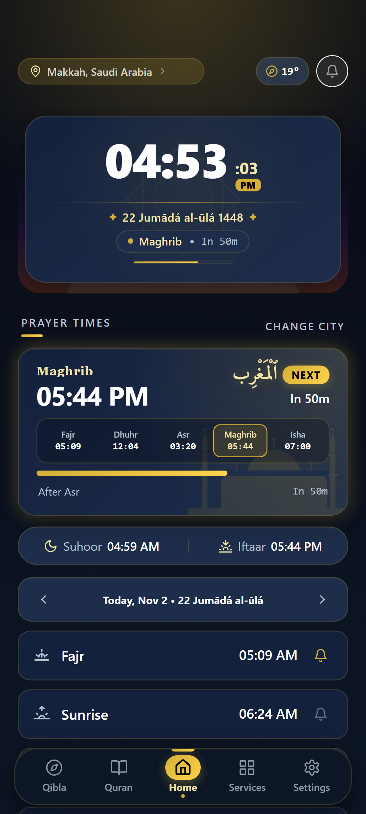
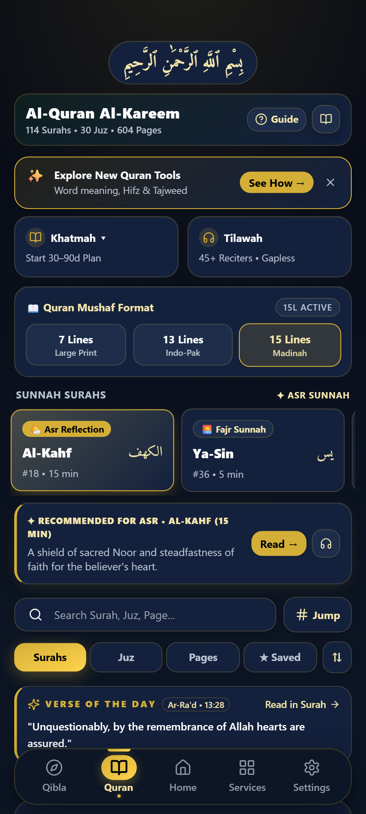
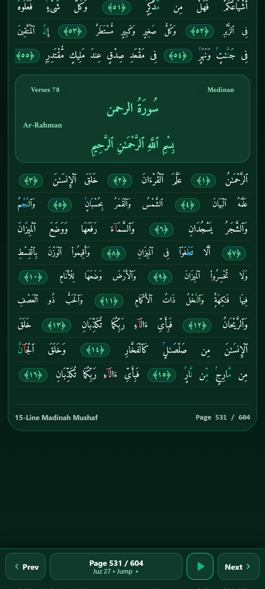
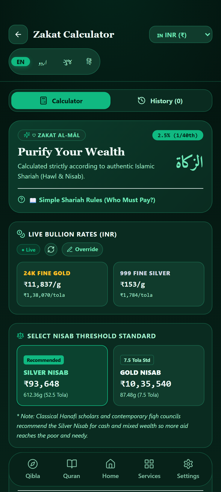
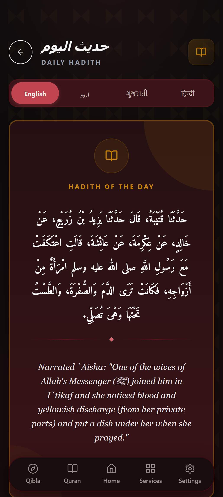
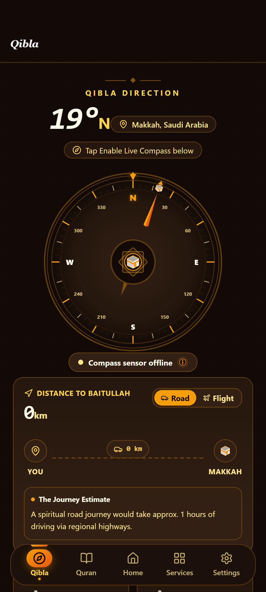
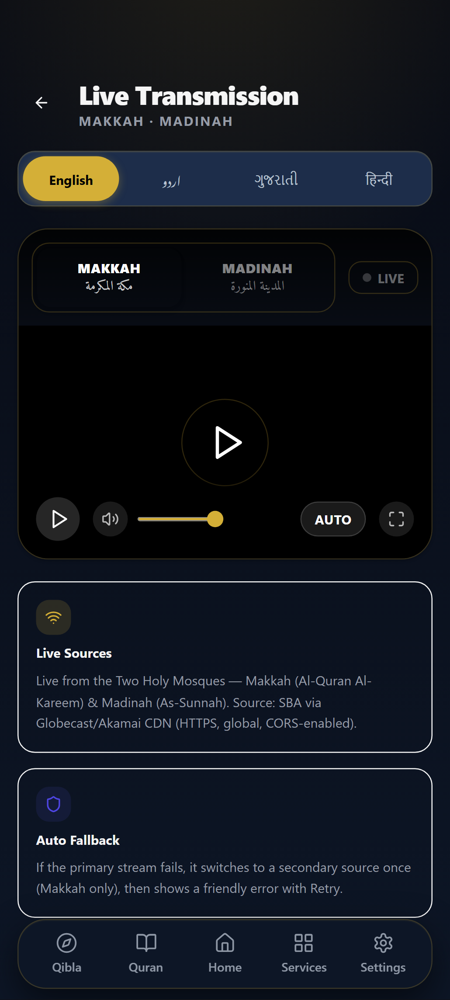
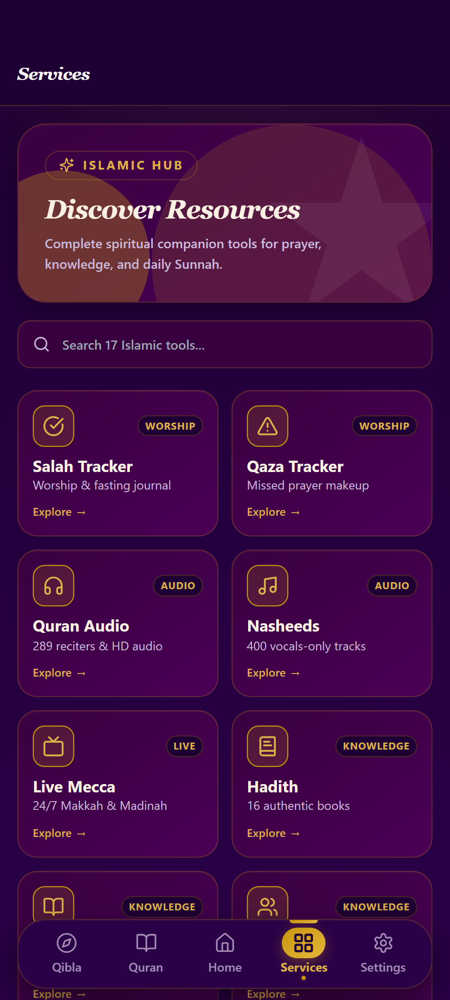
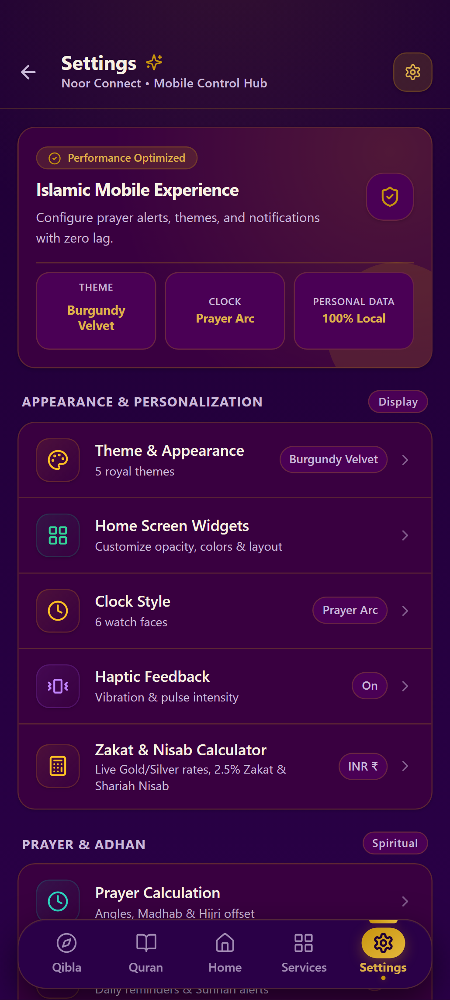
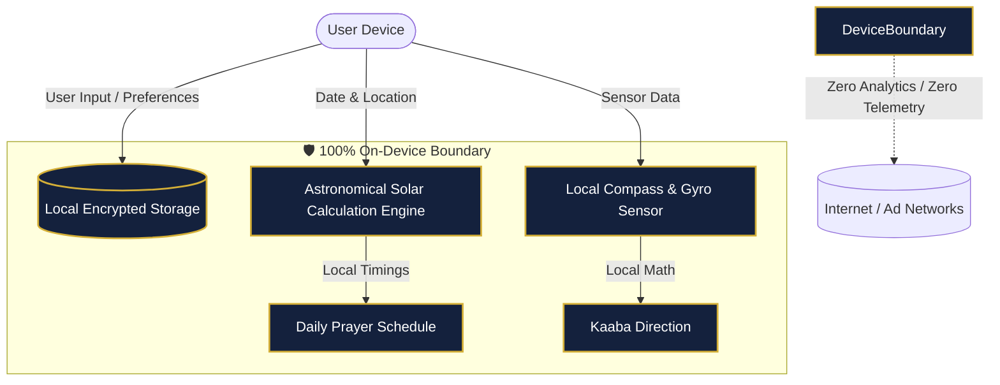

<div align="center">


# 🌙 Noor Connect
### Your Sovereign, Privacy-First Islamic Companion
**Version 2.2.1 • Android & Modern Web • 100% Offline Fallback • Zero Trackers**

[](LICENSE)
[](https://github.com/Ahmadnedariya786/Noor-connect/releases/latest)
[](https://github.com/Ahmadnedariya786/Noor-connect)
[](https://github.com/Ahmadnedariya786/Noor-connect/security/code-scanning)
[](.fdroid.yml)
[](#-privacy-first-architecture)
[](https://nocopyrightnasheed.com/)

<p align="center">
  <a href="https://github.com/Ahmadnedariya786/Noor-connect/releases/latest/download/noor-connect-nightly.apk">
    
  </a>
  &nbsp;&nbsp;
  <a href="https://github.com/Ahmadnedariya786/Noor-connect/releases/latest/download/NoorConnect-v2.2.1.apk">
    
  </a>
</p>

</div>

---

## 📖 Table of Contents

- [🌙 Overview](#-overview)
- [📲 Direct Downloads & Installation](#-direct-downloads--installation)
- [📱 Visual Showcase (v2.2.1 Screenshots)](#-visual-showcase-v221-screenshots)
- [🌟 Key Subsystems & Highlights](#-key-subsystems--highlights)
  - [📖 Quran Mushaf & Audio Suite](#-quran-mushaf--audio-suite)
  - [💰 Shariah-Compliant Zakat & Nisab Calculator](#-shariah-compliant-zakat--nisab-calculator)
  - [📚 Multi-Language Tafsir & Translations](#-multi-language-tafsir--translations)
  - [🎨 5 Royal Luxury Themes & 6 Clocks](#-5-royal-luxury-themes--6-clocks)
  - [✨ Dynamic Living Logo Engine (5 Sacred Editions)](#-dynamic-living-logo-engine-5-sacred-editions)
  - [🧭 High-Precision Qibla Compass](#-high-precision-qibla-compass)
  - [🕋 24/7 Makkah & Madinah Live Streams & Radio](#-247-makkah--madinah-live-streams--radio)
  - [📿 Complete Islamic Tools Hub](#-complete-islamic-tools-hub)
  - [📱 5 High-Performance Android Widgets](#-5-high-performance-android-widgets)
- [🛡️ Privacy-First Architecture & Security](#-privacy-first-architecture--security)
- [🛠️ Building & Development](#-building--development)
- [📜 License & Ummah Dedication](#-license--ummah-dedication)

---

## 🌙 Overview

**Noor Connect** (`com.noorconnect.ummah`) is a luxury, privacy-first Islamic companion crafted for the global Ummah. Built with modern web standards and native Android hardware integrations, it offers **zero UI friction, zero ads, zero trackers, and complete offline capability**.

Unlike conventional Islamic mobile apps that monetize spiritual habits or sell geolocation data to third-party ad brokers, Noor Connect enforces a strict **Zero-Data-Leak guarantee**:
- **Personal Data Never Leaves Your Device**: Prayer times, Quran progress, bookmarks, notes, Tasbeeh sessions, and Zakat records remain in local, encrypted on-device storage.
- **Offline-First Astronomy**: Astronomical prayer calculations and Qibla bearings run 100% locally without requiring internet access.
- **Stealth Owner Protocol**: Protected developer tools and diagnostics remain invisible to normal users, ensuring a distraction-free spiritual environment.

---

## 📲 Direct Downloads & Installation

| Asset | Target | Size | Direct Link | Checksum |
| :--- | :--- | :--- | :--- | :--- |
| **noor-connect-nightly.apk** | Android 8.0+ (ARM64 / ARMv7 / x86_64) | ~14 MB | [**Direct Download**](https://github.com/Ahmadnedariya786/Noor-connect/releases/latest/download/noor-connect-nightly.apk) | [SHA-256](https://github.com/Ahmadnedariya786/Noor-connect/releases/latest/download/noor-connect-nightly.apk.sha256) |
| **NoorConnect-v2.2.1.apk** | Official Stable Release Asset | ~14 MB | [**Direct Download**](https://github.com/Ahmadnedariya786/Noor-connect/releases/latest/download/NoorConnect-v2.2.1.apk) | [SHA-256](https://github.com/Ahmadnedariya786/Noor-connect/releases/latest/download/NoorConnect-v2.2.1.apk.sha256) |
| **version.json** | Fast In-App Auto-Updater Manifest | <1 KB | [View Manifest](https://github.com/Ahmadnedariya786/Noor-connect/releases/latest/download/version.json) | — |

### Installing the APK on Android
1. Tap **[Download Latest APK](https://github.com/Ahmadnedariya786/Noor-connect/releases/latest/download/noor-connect-nightly.apk)** directly on your Android phone.
2. When prompted by Chrome or your browser, select **Download anyway** and then tap **Install**.
3. If this is your first manual APK install, enable *"Allow from this source"* in Android Settings.
4. Noor Connect includes an in-app turbo 4-thread parallel downloader: future updates can be checked and installed in 1 tap from `Settings > About Noor Connect` or the Home update banner.

---

## 📱 Visual Showcase (v2.2.1 Screenshots)

Captured directly from the live v2.2.1 production build across all **5 Royal Themes**:

<table>
  <tr>
    <td align="center" width="33%">
      
      <br/>
      <b>Home Dashboard</b>
      <br/>
      <sub>Oxford Gold • Prayer Countdown & Clocks</sub>
    </td>
    <td align="center" width="33%">
      
      <br/>
      <b>Quran Hub & Sunnah</b>
      <br/>
      <sub>Madinah Emerald • 4-Tab Hub & Quick Surahs</sub>
    </td>
    <td align="center" width="33%">
      
      <br/>
      <b>Interactive Tajweed Mushaf</b>
      <br/>
      <sub>Madinah Emerald • 15L & 7L Reading Views</sub>
    </td>
  </tr>
  <tr>
    <td align="center" width="33%">
      
      <br/>
      <b>Zakat & Nisab Calculator</b>
      <br/>
      <sub>Burgundy Velvet • Live Rates & A4 PDF Report</sub>
    </td>
    <td align="center" width="33%">
      
      <br/>
      <b>Hadith Encyclopedia</b>
      <br/>
      <sub>Desert Scroll • 52K+ Authentic Traditions</sub>
    </td>
    <td align="center" width="33%">
      
      <br/>
      <b>Qibla Compass</b>
      <br/>
      <sub>Oxford Gold • 60 FPS Gyro & Declination</sub>
    </td>
  </tr>
  <tr>
    <td align="center" width="33%">
      
      <br/>
      <b>Live Makkah & Madinah</b>
      <br/>
      <sub>Imperial Violet • 24/7 Official SBA Streams</sub>
    </td>
    <td align="center" width="33%">
      
      <br/>
      <b>Islamic Services Hub</b>
      <br/>
      <sub>Imperial Violet • Tasbeeh, Duas & Qaza</sub>
    </td>
    <td align="center" width="33%">
      
      <br/>
      <b>5 Royal Themes & Settings</b>
      <br/>
      <sub>Burgundy Velvet • Deep X-Ray Diagnostics</sub>
    </td>
  </tr>
</table>

---

## 🌟 Key Subsystems & Highlights

### 📖 Quran Mushaf & Audio Suite
- **Dual Mushaf Modes**: Toggle effortlessly between the standard **15-Line Madani Mushaf** (604 pages) and the **7-Line IndoPak Mushaf** with custom line-formatting algorithms.
- **Word-by-Word Interactive Tajweed**: Color-coded pronunciation guidance (Ghunnah, Ikhfa, Idgham, Qalqalah, Madd) with interactive Ayah Study sheets.
- **47+ Authentic Reciters**: Murattal, Mujawwad, and Mu'allim (Teacher) recitations by world-renowned Qaris (Mishary Rashid Alafasy, Abdul Basit Abdul Samad, Mahmoud Khalil Al-Husary, Abu Bakr Al-Shatri, Saad Al-Ghamdi, Maher Al-Muaiqly, and more).
- **Advanced Tilawah Player**:
  - Repeat Each Ayah (1×, 2×, 3×, 5×, ∞)
  - Custom Interval Ranges (Start Surah:Ayah → End Surah:Ayah)
  - Ayah Delay (0s to 15s pause between verses for reflection or memorization)
  - Speed Controls (0.5×, 0.75×, 1.0×, 1.25×, 1.5×, 2.0×)
  - 100% In-App Audio Caching for offline playback.

### 💰 Shariah-Compliant Zakat & Nisab Calculator
- **Live Multi-Currency Metal Rates**: Real-time spot prices for Gold (**XAU**) and Silver (**XAG**) across INR (₹), USD ($), SAR (﷼), AED (د.إ), and PKR (₨).
- **Purity Breakdown & Weights**: Support for 24K, 22K, 21K, and 18K purities in Grams and Tolas (1 tola = 11.6638g).
- **Silver & Gold Nisab Thresholds**: One-tap toggle between classical Silver Nisab (612.36g) and Gold Nisab (87.48g) with instant eligible/ineligible status badge.
- **8 Wealth Categories**: Cash & Bank Balances, Gold & Silver Jewelry, Business Inventory, Stocks & Mutual Funds, Real Estate Investments, Agriculture & Produce, Livestock (Camels, Cattle, Sheep/Goats), and Deductible Immediate Liabilities.
- **Professional 1-Page A4 PDF Export**: Clean vector PDF generation containing your complete calculation breakdown, Nisab threshold, currency summary, and native Android share sheet integration.

### 📚 Multi-Language Tafsir & Translations
- **Authentic Commentary Books**: Instant commentary from Ibn Kathir, Tafheem-ul-Quran (Maududi), Jalalayn, Maarif-ul-Quran, and modern scholarly treatises.
- **Typographic Localization**:
  - **Urdu** in exquisite **Jameel Noori Nastaliq** with RTL typographic scaling.
  - **English**, **Gujarati**, **Hindi**, **Arabic**, **Bengali**, **Turkish**, **Russian**, and **French**.
- **Offline Downloadable Packs**: Download translation packs locally for seamless offline study.

### 🎨 5 Royal Luxury Themes & 6 Clocks
- **5 Custom Palettes**:
  1. `Oxford Gold` (Classic Midnight & Radiant Gold)
  2. `Madinah Emerald` (Sacred Green & Polished Brass)
  3. `Imperial Violet` (Royal Amethyst & Rose Gold)
  4. `Burgundy Velvet` (Deep Crimson & Vintage Bronze)
  5. `Desert Scroll` (Warm Papyrus & Antique Terracotta)
- **6 Dynamic Digital Clocks**: Minimalist, Ottoman Dial, Hijri Dual-Time, Lunar Phase, Arabic Numerals, and Classic Digital.
- **Theme Variables**: Engineered with CSS custom properties and automatic fallbacks for maximum 60 FPS fluidity.

### ✨ Dynamic Living Logo Engine (5 Sacred Editions)
- **Living Emblem System**: Rather than a static flat icon, Noor Connect features a dynamic, 3D-metallic vector emblem engine that morphs across **5 handcrafted sacred editions**:
  1. **Edition 0: Al-Miftah Royal Mihrab & Blooming Mushaf** (Flagship Royal Arch & Open Scripture)
  2. **Edition 1: Celestial Rub el Hizb Mandala & Sacred Fanous** (8-Point Islamic Star & Glowing Lantern)
  3. **Edition 2: Haramain Sanctuary Crest & Minarets** (Twin Grand Minarets & Crescent Dome)
  4. **Edition 3: Noor Al-Quran 3D Flame Medallion** (Light of Divine Revelation Medallion)
  5. **Edition 4: Mamluk Royal Starburst & Qibla Sanctuary** (Sacred Geometric Starburst)
- **Automatic Multi-Factor Rotation**: Rotates dynamically across app launches and adapts to spiritual times of day (Fajr sunrise gold, Tahajjud midnight celestial sapphire, Maghrib sunset amber).
- **Interactive Manual Switch**: Users can tap the emblem or the switcher pill in `Settings > About Noor Connect` to cycle and preview all 5 editions in real time.
- **Adaptive Android & Web Icons**: Brand-new ultra-high-definition launcher icons (mdpi through xxxhdpi) and PWA app icons rendered with 24K gold foil and deep emerald velvet.

### 🧭 High-Precision Qibla Compass
- **Hardware-Accelerated Gyro**: Direct magnetometer sensor access with low-pass filters to prevent needle jitter.
- **True North & Declination**: Real-time World Magnetic Model (WMM) declination correction calculating the exact angle to the Holy Kaaba in Makkah.
- **Haptic Alignment Lock**: Subtle vibration triggers when your device perfectly aligns with the Qibla.

### 🕋 24/7 Makkah & Madinah Live Streams & Radio
- **Official SBA CDN Broadcasts**: High-definition video streams direct from the Grand Mosque in Makkah and the Prophet's Mosque in Madinah.
- **Global Quran Radio**: 200+ online Islamic radio streams covering 24/7 Tilawah, English/Urdu translations, Tafsir explanations, and Islamic lectures.
- **Partnership with No Copyright Nasheed**: 400+ officially licensed, high-bitrate nasheeds with lyrics sync, sleep timers, and background playback.

### 📿 Complete Islamic Tools Hub
- **Digital Tasbeeh**: Customizable Dhikr counter with Zen Mode, milestone targets (33, 99, 100), and vibration feedback.
- **Hadith Encyclopedia (52,000+ Traditions)**: 16 complete books (Sahih al-Bukhari, Sahih Muslim, Sunan Abi Dawud, Jami` at-Tirmidhi, Sunan an-Nasa'i, Sunan Ibn Majah, and more) with grade verification badges (Sahih, Hasan, Da'if).
- **Hisnul Muslim & Duas**: 80+ supplications categorized by daily occasions with transliteration, audio, and search.
- **99 Names of Allah (Asma-ul-Husna)**: Beautiful calligraphy, meaning, and benefits of reflection.
- **Prophetic Medicine (Tibb-e-Nabawi)**: Mood-based index offering spiritual remedies from the Quran and Sunnah.
- **Qaza Salah Tracker & Menstrual Mode**: Comprehensive prayer debt management with intelligent habit preservation during cycles.

### 📱 5 High-Performance Android Widgets
- **Next Prayer (4×2 & 4×1)**: Real-time countdown timer, next prayer badge, and location chip.
- **Daily Ayah (4×2)**: Beautiful Arabic typography with RTL support and English translation.
- **Daily Hadith (4×2)**: Rotating daily hadith with color-coded authentication badge.
- **Quran Progress (4×2)**: Circular completion ring and reading streak tracker.
- **Tasbeeh Counter (2×2)**: Tap-to-increment counter with zero-latency `PendingIntent` execution.

---

## 🛡️ Privacy-First Architecture & Security



1. **Zero Tracking**: No Google Analytics, no Firebase Analytics, no Facebook SDK, no advertising IDs.
2. **0 CodeQL Alerts**: Clean codebase verified against GitHub CodeQL security analysis with 0 vulnerabilities (`js/incomplete-multi-character-sanitization`, `js/clear-text-storage-of-sensitive-data` fully resolved).
3. **Stealth 5-Tap Developer Vault**: The developer security vault in `Settings > About Noor Connect` remains completely hidden until tapping the version badge 5 times within 3 seconds, protected by one-way salted SHA-256 zero-knowledge proofs.

---

## 🛠️ Building & Development

### Prerequisites
- **Node.js**: v18.0.0 or newer (v20+ recommended)
- **JDK**: Java 17 (Temurin)
- **Android SDK**: API level 34+ (Build tools 34.0.0 / 36.0.0)

### 1. Clone & Install Dependencies
```bash
git clone https://github.com/Ahmadnedariya786/Noor-connect.git
cd Noor-connect
npm ci
```

### 2. Run Local Development Server
```bash
npm run dev
# The web app will launch at http://localhost:5173
```

### 3. Verification Pipeline (Typecheck & Lint)
```bash
node scripts/typecheck.cjs  # 0 errors
npm run lint               # 0 errors
npm run build              # Builds production web bundle in dist/
```

### 4. Capture Real High-Res Screenshots
```bash
# Automated headless Chrome CDP capture across all 5 themes
node scripts/capture-real-screenshots.cjs
```

### 5. Build Android Release / Debug APK
```bash
# Clean dist and sync Capacitor Android bridge
node scripts/clean-dist-data.js
npx cap sync android

# Build Debug APK
cd android
./gradlew assembleDebug

# Build Release Signed APK
./gradlew assembleRelease
```
The generated APK will be placed in `android/app/build/outputs/apk/release/app-release.apk`.

---

## 📜 License & Ummah Dedication

This project is free and open-source software licensed under the **[GNU General Public License v3.0 (GPL-3.0-or-later)](LICENSE)**.

```
Noor Connect — Modern Islamic Companion
Copyright (C) 2026 Ahmad Nedariya and Noor Connect Contributors.

This program is free software: you can redistribute it and/or modify
it under the terms of the GNU General Public License as published by
the Free Software Foundation, either version 3 of the License, or
(at your option) any later version.
```

<div align="center">
  <br/>
  <p><i>"Indeed, in the remembrance of Allah do hearts find rest." (Surah Ar-Ra'd 13:28)</i></p>
  <b>Crafted with love and devotion for the global Muslim Ummah 🌍</b>
</div>
