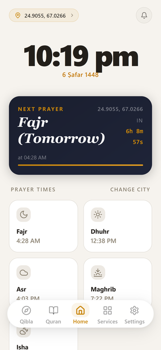
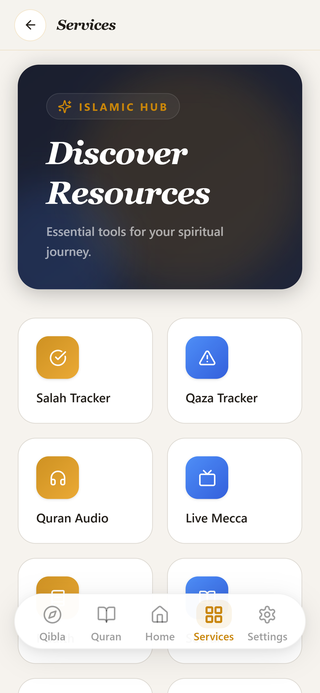
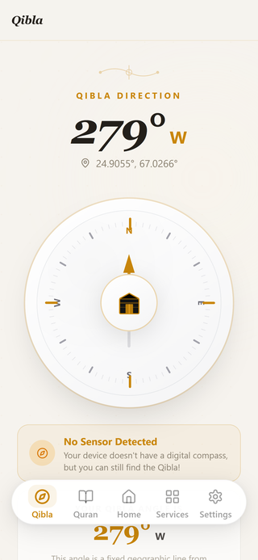
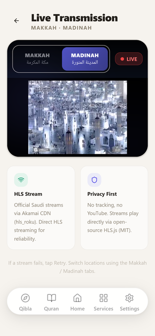
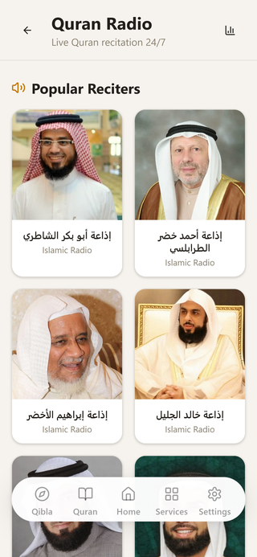
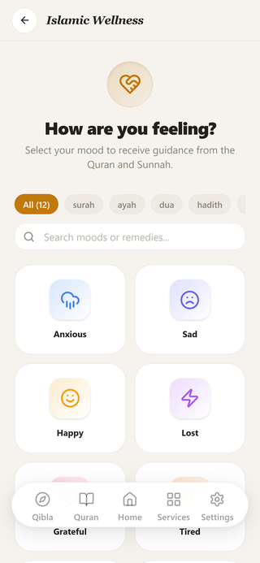
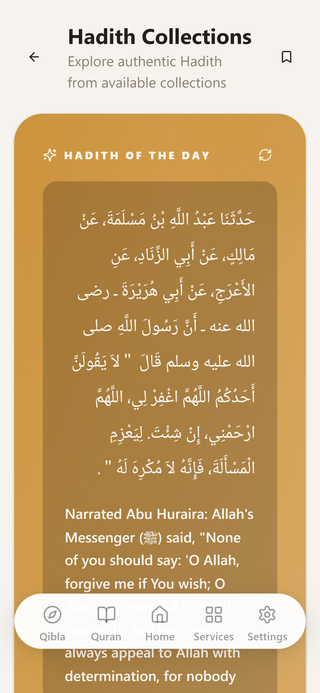
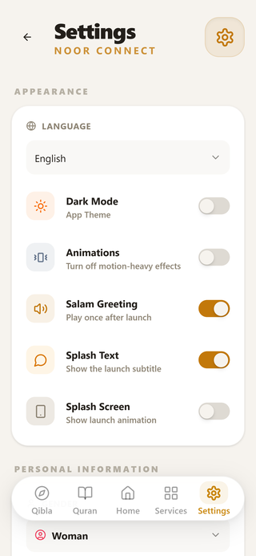

# 🌙 Noor Connect - Your Ultimate Islamic Companion

[](https://opensource.org/licenses/GPL-3.0) [](https://github.com/darkmaster0345/Noor-connect) [](.fdroid.yml) [](CHANGELOG.md) []() []()

**Noor Connect** is a truly comprehensive, beautiful, and strict privacy-focused Islamic application designed to help you stay connected with your faith. Built to modern mobile standards using web technologies (React + Vite + Capacitor), it stands as a premium, tracker-free digital companion for spiritual growth.

---

## 🎯 **Our Mission & Origin Story**

Noor Connect was born from a simple frustration: **there was no single Islamic app that offered comprehensive features without compromising user privacy.**

The mainstream Islamic app market is dominated by apps that:
- 📊 **Sell your location data** to third parties (documented cases with major apps)
- 📱 **Track your prayer habits** for advertising profiles
- 🔍 **Monitor your Quran reading** for analytics
- 💰 **Monetize your spiritual data** without consent

**Noor Connect was built differently** — by a Muslim who needed a complete Islamic toolkit but refused to trade privacy for convenience. Every feature exists because the developer personally needed it, and every architectural decision prioritizes **your sovereignty over your spiritual data**.

### 🏆 **Partnership: No Copyright Nasheed**
We're proud to announce our partnership with **[No Copyright Nasheed](https://nocopyrightnasheed.com/)** — the leading platform for copyright-free Islamic nasheeds.

- ✅ **Official License Grant**: Free perpetual license to integrate 400+ premium nasheeds
- ✅ **Official Feature**: Noor Connect is now featured on the [No Copyright Nasheed website](https://nocopyrightnasheed.com/) as a trusted partner
- 🎵 **Released in v2.2**: 400+ curated nasheeds with a highly optimized audio player.

This partnership ensures every nasheed is legally licensed, high-quality, and supports the creators — aligning perfectly with our Islamic ethics.

---

## 🆕 What's New in v2.2.0

### 📻 Live Streams Reliability (Hotfix)
- **Fixed Broken Makkah & Madinah Streams**: Replaced the CORS-blocked Aloula CDN redirect URLs (which browsers reject before playback ever starts) with verified, CORS-enabled `m.live.net.sa` HLS streams as the primary sources.
- **Automatic Source Fallback**: If the primary stream fails, the player automatically switches to the secondary Aloula source once before showing a friendly "Stream temporarily unavailable. Please try again later." message.
- **Android Cleartext Whitelist**: `m.live.net.sa` added to the network security config so the streams play on Android (cleartext HTTP on port 1935).
- **Android Fullscreen Rendering Fix**: Entering fullscreen now uses native `requestFullscreen` + landscape orientation lock on Android, fills the entire screen edge-to-edge (`100vw`/`100vh` with safe-area insets), and recalculates video sizing on `resize`/`orientationchange` so the picture stays centered with `object-fit: contain`. Exiting fullscreen restores the 16:9 layout and unlocks orientation.
- **Quality Selector Cleanup**: Quality picker is now hidden when the active stream only exposes a single quality level (the primary `m.live.net.sa` streams are single-variant 720p), keeping the controls clean.

### 🕌 Major Prayer Times & Quran Refactor
- **usePrayerTimes Hook Complete Rewrite**: Simplified logic with signature-based caching deduping, robust fallback chain (geolocation → stored → manual → timezone default), and separated notification scheduling into new `usePrayerNotifications` hook with 1s throttle.
- **Removed Standalone Mushaf Viewer**: Deleted the standalone `/mushaf` image-based viewer feature to streamline the app. The app now exclusively uses the vertical-scrolling `/quran` reader (which still utilizes the beautiful Madani Mushaf WebP images and integrates with recitation progress/streaks).
- **GlobalPrayerAlarm Optimization**: localStorage caching skips redundant geolocation/API calls when today's times already cached; abort controller for clean fetch cancellation.

### 🎵 Nasheed Player Upgrades
- **New Equalizer Component**: Animated audio visualizer with configurable bars, colors, heights, and animation timing.
- **Offline Playback Cache**: Played nasheeds cached for offline listening (200 tracks, 90-day retention, quota-safe) with cache status indicators.
- **Filter by Artist**: Quick artist-filter chips for browsing 400+ nasheed library.
- **Back to Top**: Instant jump to top of long library lists.

### ⚡ Performance & Core Web Vitals
- **Added react-window & @types/react-window** for virtualized list support.
- **Prayer Times Hook**: Race condition fixes (removed stale ref checks), `parseTime` throws on invalid input instead of returning current time.
- **GlobalPrayerAlarm**: Module-level side effects moved to `useEffect`; event listener type safety fixed; missing cleanup listeners added.

### 🛡️ Code Quality & Lint Fixes
- **Resolved 12 lint errors**: 5 empty catch blocks (added non-critical comments), 1 `require()`→`import` conversion, 4 `@ts-ignore`→`@ts-expect-error` with descriptions, 1 parsing error (extra closing braces).
- **Settings.tsx**: Fixed empty catch block (eslint error).
- **TypeScript**: Stricter types in prayer times and alarm modules.

### 🕌 Prayer Tracking & Qaza Fixes (from 2026-07-31)
- **Critical Prayer Tracking Bridge**: `syncMissedPrayersToQaza()` moved from unused SalahTracker into Dashboard.tsx — missed prayers auto-detected and added to qaza from home screen.
- **Dashboard Prayer Time Validation**: Check-in passes prayer times to `togglePrayer()`, showing "Cannot check in before prayer time" error instead of silently bypassing.
- **Qaza History Centralized**: Moved to `qaza-tracker.ts` lib functions (`getQazaHistory`, `addQazaHistoryEntry`, `getQazaDailyGoal`, `setQazaDailyGoal`).
- **Streak Reset on Foreground**: `visibilitychange` listener calls `checkStreakReset()` on app return, ensuring streaks reset correctly after days away.
- **Hadith Collection Flash Fix**: `HadithBookView` initializes `metadataLoading` to `true`, checks `remoteCollectionData` for loading guard — eliminates "1 book" flash.

### 🧹 Dead Code Cleanup
- **Deleted Unused Components**: `SalahTracker.tsx` (205 lines), `PrayerTimesList.tsx` (451 lines), `EnhancedPrayerTimesList.tsx` (111 lines) — imported but never rendered.
- **Dashboard Cleanup**: Removed unused lazy imports for `PrayerTimesList`, `SalahTracker`, `QazaTracker`.

### 🌐 Complete Language & Translation Overhaul
- **All 5 Languages Synchronized**: English, Arabic, Urdu, Bengali, Russian — 410 translation keys each (was 278-314 with 99-105 missing).
- **Hardcoded English Strings Eliminated**: 20+ AppBar titles, BottomNav labels, DashboardFeatureCards now use `t()`.
- **Locale-Aware Formatting**: `time-formatter.ts`, `useI18n.ts`, `widget-service.ts` respect selected language.
- **RTL/Widget Sync Consistency**: Migrated to `useLanguage()` for proper RTL and widget string sync.
- **Widget String Sync**: Android widgets receive translated prayer labels in all 5 languages.

### 🔔 Intelligent Notification Engine
- **Ghost Notification Fix**: Ramadan reminders (Suhoor, Iftar, Tarawih) no longer persist into other months — safety clear on-boot sweeps native OS buffer.
- **Deterministic Scheduling**: Predictable ID mapping (`Suhoor: 2001`, `Iftar: 2002`) replaces random hashes for proper overwrite/cancel.
- **Accurate Calendar Countdowns**: Async `islamicCalendarService` replaces deprecated tabular estimates.

### 🛡️ Bulletproof Backup & Restore System
- **Unified Backup Service**: Single `backup-service.ts` consolidates legacy systems — existing backups auto-migrated on first launch.
- **Complete Data Capture**: All localStorage + Capacitor Preferences + e-book metadata, Seerah/Qisas/Hadith progress, quiz economy, sleep settings, global player states, Eid checklists.
- **Always-On Auto Save**: Snapshot every 20 min of use + on app close; latest overwrites previous; offered back on reinstall.
- **Google Cloud Backup Rules**: `backup_rules.xml` + `data_extraction_rules.xml` declare WebView storage and preferences for Android Auto Backup (caches excluded for 25MB limit).
- **Real Export on Android**: Backup button opens system share sheet (save to Downloads, Drive, Files) — previously failed silently in WebView.
- **First-Launch Restore Prompt**: Auto-detects previous data after reinstall, offers one-tap restore.
- **Never Loses Data Silently**: Verifies integrity, warns on older-over-newer import, recovers partially from failures, reports in plain language.

---

## 🚀 **Nasheed Library (v2.2)**

### 🎵 **400+ Premium Nasheeds — Legally Licensed & Free**

In partnership with **No Copyright Nasheed**, we're bringing the largest curated nasheed library to any Islamic app:

| Feature | Details |
|---------|---------|
| **Library Size** | 400+ premium nasheeds (expanding) |
| **Licensing** | Official free perpetual license from No Copyright Nasheed |
| **Artists** | Curated from top Islamic nasheed artists globally |
| **Categories** | Hamd, Naat, Islamic motivation, Ramadan, Eid, kids |
| **Languages** | Arabic, English, Urdu, Turkish, Malay, more |

### 📶 **Adaptive Streaming for Weak Connections**
- **Smart Bitrate**: Auto-adjusts quality (32kbps → 128kbps) based on connection
- **Smart Caching**: Preloads next nasheed during playback
- **Offline Queue**: Download on wifi, listen anywhere
- **Data Saver**: <5MB/hour on lowest quality
- **Background Play**: Continues when screen off / app backgrounded

### 🎛️ **Smart Features**
- **Sleep Timer**: Auto-stop after 15/30/60 minutes
- **Playback Speed**: 0.5x → 2x for learning/memorization
- **Lyrics Sync**: Time-synced lyrics display (where available)
- **Favorites & Playlists**: Build personal collections
- **Daily Nasheed**: Curated daily recommendation
- **Background Download**: Queue downloads on wifi only

> **Official Partnership**: Noor Connect is now featured on the [No Copyright Nasheed website](https://nocopyrightnasheed.com/) — the first Islamic app to receive this recognition.

---

## ✨ The Complete Feature Set

### 📖 Enhanced Quran & Tafsir Explorer

- **Complete Holy Quran**: Clean, beautifully styled reading interfaces with ** Madani Mushaf WebP images** (604 pages). Advanced caching system prefetches pages for instant display.
- **Standard Mushaf Implementation**: Industry-standard **Madani Mushaf layout** with optimized WebP storage for privacy-first offline Quran reading.
- **Advanced Tafsir System**: 25+ global Quranic commentary editions instantly accessible via high-speed spaCy API integration, eliminating heavy database overhead.
- **Multilingual Support**: Read meanings and Tafsir in English, Arabic, Bengali, Urdu, and Russian.
- **Recitation Playback**: Immersive background audio from multiple reciters with progress tracking.

### 🕋 Premium Qibla Compass
- **High-Precision Native Sensors**: Completely overhauled native compass utilization tapping into device magnetometers for raw, smooth orientation. 60fps hardware-accelerated JS interpolation eliminates sensor jitter and UI lag on legacy Android devices.
- **Muslim Pro Grade UI**: Exquisite SVG-based compass dial with Kaaba alignment glow effects, jitter-reducing low-pass filters, and haptic feedback upon true Qibla lock.
- **Web & Manual Fallback**: If sensors fail, the app gracefully falls back to GPS/Web-oriented calculation paths.

### 📅 Advanced Islamic Calendar & Events
- **Complete Hijri Calendar**: View Gregorian and Hijri dates side-by-side with global offset adjustments.
- **Ramadan Mode**: A comprehensive fasting hub featuring Suhoor/Iftar countdowns, daily Taraweeh progress tracking, hydration reminders, and specialized Ramadan Duas.
- **Holiday Countdowns**: Automated visual countdowns for major Islamic events like Eid al-Fitr, Eid al-Adha, and Laylat al-Qadr.

### ⏲️ Smart Prayer Times & Adhan Control
- **Offline Calculation**: Fast, precise, localization-based timings for Hanafi and Shafi'i madhabs generated fully offline.
- **Granular Adhan Toggles**: Selectively enable or disable Adhan alarms per individual prayer using deep native background alarms—silence Asr without muting Maghrib!
- **Optimized TTS & Audio**: Highly tuned Adhan playback utilizing an advanced audio engine to prevent interruptions or background sleep killing. 

### 📿 Complete Spiritual Tracking & Menstrual Mode
- **Gender-Adaptive Onboarding**: Intelligent routing that completely re-adapts internal features based on the user.
- **Menstrual Mode**: Carefully tracks cycles, automatically silencing obligatory Adhans, halting Salah charts, and adjusting habit trackers during breaks without breaking daily login streaks.
- **Qaza & Habits**: Keep a long-term offline ledger of your missed prayers (Qaza Tracker), digital Tasbeeh goals, and weekly spiritual habit consistency.
- **Salah Focus Timer**: A dedicated Do-Not-Disturb timer to help you maintain khushu (focus) during prayer.
- **Mood-Based Reflections**: Enhanced Mood Selector providing tailored Daily Ayahs and Islamic Greetings based on how you feel.

### 📚 Islamic Life & Education Tools
- **Zakat & Fitrana Calculators**: Advanced offline calculators to accurately determine your annual Zakat and Ramadan Fitrana obligations. Features gold and silver weight calculators with purity options, real-time exchange rate tracking with fallback for offline use, preferred currency settings, and automatic rate updates when online.
- **Hisnul Muslim & Duas**: Comprehensive library of authentic supplications for all occasions.
- **Names of Allah (Asma-ul-Husna)**: Beautifully rendered 99 Names of Allah with meanings and fluid animations.
- **Enhanced Islamic Quiz**: Test your knowledge of Deen with interactive, gamified Islamic quizzes. Includes daily rewards, combo multipliers, mystery boxes, and reliable cross-platform gamification logic.
- **Islamic Remedies (Tibb-e-Nabawi)**: Prophetic medicine index with a favorites list for quick reference.
- **Eid & Festive Checklist**: Special event mode with checklists and celebratory popups to prepare for Eid and other significant Islamic events.
- **Prayer Statistics & Analytics**: Detailed visual graphs tracking prayer completion, Qaza history, and weekly/monthly performance.
- **Spiritual Habit Tracker**: Track daily habits (like reading Quran, giving charity) with streak preservation.

### 📖 History & Literature
- **Seerah of the Prophet (ﷺ)**: Comprehensive biography reader with chapters, categorization (Makkan, Madinan), and reading progress tracking.
- **Qisas Al-Anbiya**: Detailed stories of the Prophets with progress tracking and categorized reading sessions.
- **Ebooks Library**: Modern Islamic ebooks reader for deeper theological exploration.

### 📻 Rich Media & Islamic Library
- **Hadith Encyclopedia (87K)**: 16 complete collections with Arabic + English, grade badges, bookmarks, daily hadith widget, and full-text navigation.
- **24/7 Quran Radio & Streams**: Direct live video and audio streams from Makkah and Madinah via CORS-enabled HLS (m.live.net.sa primary, Aloula CDN fallback) with automatic source-switching and friendly error handling. Android cleartext whitelist included.
- **Radio Statistics & Achievements**: Track your listening habits with detailed statistics per station, total listening time, streak tracking, and unlockable achievements for consistent listening.
- **Mushaf Image Optimization**: Local asset storage with Gradle-based image moving during Android build to eliminate duplication. Uses **standard Madani Mushaf** (industry standard for Muslim world with 604 pages).
- **🎵 Nasheed Library (v2.2)**: 400+ legally licensed nasheeds via official No Copyright Nasheed partnership. Adaptive streaming for 2G/weak wifi, offline download, sleep timer, lyrics sync, and curated daily recommendations. **Officially featured** on No Copyright Nasheed website.

### 🎵 Dedicated Nasheed Player (v2.2+)

- **Official No Copyright Nasheed Partnership**: Exclusive integration with 400+ high-quality nasheeds from the renowned No Copyright Nasheed platform — **legally licensed** and **officially featured** on their website.
- **Adaptive Streaming**: Smart bitrate adaptation (64kbps/128kbps/256kbps) for seamless playback on 2G, weak wifi, or limited data — no buffering, ever.
- **Offline-First**: One-tap download for complete offline listening. Automatic cleanup of old downloads when storage is low.
- **Smart Player Features**:
  - Sleep timer with fade-out (5/15/30/60 min)
  - Lyrics synchronization (LRC format) with word-by-word highlighting
  - Curated daily recommendations based on time, mood, and history
  - Continuous playback with crossfade between tracks
  - Background playback with notification controls
- **Categories**: Morning/Evening adhkar, Ramadan, Eid, Kids, Arabic/English/Urdu, Instrumental, Acapella

### 📱 Android Integration & Security
- **Native Android Widgets**: Home screen widgets for Next Prayer, Quran Reading Progress, Daily Ayah, Daily Hadith, and a Digital Tasbeeh. Everything auto-syncs with your in-app progress.
- **Auto Backup & Restore**: Robust always-on backup system that automatically secures your settings, bookmarks, Qaza records, Quran progress, and all Capacitor Preferences (like Nasheed radio stats, theme preferences, and advanced hardware configurations). No toggle — the latest snapshot is saved every 20 minutes and on app close. Declares full Android Auto Backup rules so Google Drive silently syncs your data and it is offered back on re-install.
- **Advanced Notification System**: 
  - **Heads-Up Adhaan**: Deep native integration for high-priority, full-screen intent Adhaan notifications with direct lock-screen controls to "Stop Adhaan" or "Open App".
  - **Context-Aware Prayer Quotes**: Intelligent prayer reminders that attach specific Quranic Ayahs or Ahadith related to the exact prayer time (e.g. Fajr-specific Hadith for Fajr reminders).
  - **Modern Notification History**: Beautiful, fully-featured notification history tracking UI with rich visual cards, status badges, timestamp grouping, and categorical filtering.
- **Privacy-First**: No listening analytics, no tracking, all data local. Optional anonymous usage stats (opt-in only).


### 📱 Native Android Widgets Suite (v2.2 Hardened)
- **5 High-Performance Native Widgets**:
  - **Next Prayer Widget (4×2 & 4×1)**: Real-time countdown timer, progress ring, next prayer badge, and location chip. Uses exact alarms for sub-second prayer transitions.
  - **Daily Ayah Widget (4×2)**: Beautiful typography using *Scheherazade New* font, RTL support, Surah/Ayah reference chip, and English translation.
  - **Daily Hadith Widget (4×2)**: Complete Hadith snippet with color-coded grade badge (Sahih, Hasan, Da'if), book source chip, narrator attribution, and RTL alignment.
  - **Quran Progress Widget (4×2)**: Circular progress ring, current Surah badge, total completion percentage, streak counter, and Ramadan goal progress indicator.
  - **Tasbeeh Counter Widget (2×2)**: Interactive tap-to-increment counter with zero-latency `PendingIntent` execution, haptic vibration feedback, target rollover, and instant reset button.
- **Architectural Resilience & Performance**:
  - **Single Source of Truth (`WidgetPrefs`)**: Backed by Android `SharedPreferences` with atomic synchronization to prevent race conditions during rapid taps.
  - **WorkManager Refresh Engine (`WidgetRefreshWorker`)**: 30-minute periodic update loop with automatic self-stop when no widget instances are on the home screen to conserve battery.
  - **Exact Alarm Manager (`WidgetAlarmScheduler`)**: Schedules high-precision alarms for prayer times; automatically degrades to 15-minute inexact windows if exact alarm permission is denied on Android API 31+.
  - **System Event Survival (`WidgetBootReceiver`)**: Automatically restores prayer alarms, enqueues periodic syncs, and refreshes layouts after device reboot (`BOOT_COMPLETED`, `LOCKED_BOOT_COMPLETED`), time zone change (`TIMEZONE_CHANGED`), manual time set (`TIME_SET`), or language change (`LOCALE_CHANGED`).
  - **Background Motion & Location Sync (`WidgetForegroundService`)**: Battery-friendly step detection and location monitoring (10km threshold) to update widgets during travel.
  - **Capacitor Bridge (`WidgetBridge`)**: TypeScript layer with strict runtime validation (`validatePrayerPayload`, `validateQuranProgressPayload`), automatic exponential backoff retries, and no-op web fallbacks.
  - **Responsive Scaling & Layouts**: Configured with standard Android grid dimensions (`targetCellWidth="4"`, `targetCellHeight="2"`), auto-fitting text views, `ellipsize="end"`, and graceful empty states (`layout_empty`) to ensure pixel-perfect rendering across all screen densities (from mdpi up to xxxhdpi).

---

## 🚀 Technical Architecture & Privacy

Noor Connect is built from the ground up for performance and ethical transparency.

- **Frontend Core**: React 18, TypeScript, Vite, Tailwind CSS, & Framer Motion.
- **Enterprise GitHub Upgrades**: Built-in auto-updater component that checks the GitHub repository directly. You can update your APK entirely detached from major app stores.
- **F-Droid First (FOSS)**: 
  - Strictly **Zero Analytics**, **Zero Trackers**. 
  - Pre-configured `foss` Gradle flavor specifically built to strip `play-services` for pure open-source distribution. 
  - Fastlane F-Droid metadata integration ready.
  - **APK Size Optimization**: Implemented a comprehensive F-Droid prebuild script (`clean-dist-data.js`) to strip >300MB of redundant JSON data from bundled assets. Uses **local Mushaf WebP storage** and CDN fallback to maintain feature completeness while keeping footprint manageable.
- **Data Portability**: Full App Backup & Restore capabilities directly to internal storage (localStorage + Capacitor Preferences). The latest snapshot is saved automatically every 20 minutes and on app close, with an automatic restore prompt after reinstall. All data stays strictly local.
- **Unified Backup Service**: A single `backup-service.ts` consolidates the legacy backup systems — old backups are auto-migrated on first launch. Platform-aware export: Android opens the native share sheet (Capacitor Filesystem + Share), web uses blob download. Every operation returns a typed result with plain-language errors — nothing fails silently.
- **Android Auto Backup Rules**: `backup_rules.xml` + `data_extraction_rules.xml` include WebView storage, Capacitor Preferences and widget prefs (large caches excluded to respect the 25MB cloud limit), so Google's silent cloud backup survives uninstall/reinstall on eligible devices.
- **Low-End Device Optimizations** (2016+ devices, 30+ FPS target):
  - Adaptive device detection (`device-performance.ts`) — CPU cores, device memory, connection type, save-data mode
  - Automatic animation reduction (`shouldReduceAnimations`) respecting `prefers-reduced-motion`
  - Debounced/throttled event handlers
  - IntersectionObserver lazy loading, critical resource preloading
  - Performance mode presets: low/medium/high based on hardware
  - **Singleton FPS monitor**: Module-level RAF loop with ref counting — only 1 loop total, auto-stops when no listeners remain
- **React Query Tuning**: Stale times, cache times, and retry policies adapted for constrained devices

---

## 🛠️ Getting Started (Local Development)

### Prerequisites
- **Node.js**: v18+
- **Android Studio / Gradle**: Required to build native Capacitor packages

### Clone & Run
```bash
git clone https://github.com/darkmaster0345/Noor-connect.git
cd Noor-connect
npm install

# Run the local frontend Vite instance
npm run dev
```

### Build & Export Android / F-Droid

For a standard Android APK targeting Google APIs:
```bash
npm run build
npx cap sync android
npx cap open android
```

For F-Droid (Strict FOSS, No Proprietary Blobs):
As per the `.fdroid.yml` config, run Gradle with the `foss` directive:
```bash
./gradlew assembleRelease -Pfoss=true
```

---

## 📄 License & Open-Source

This project is licensed under the [GNU General Public License v3.0](LICENSE).

<p align="center">
  <i>"Indeed, in the remembrance of Allah do hearts find rest." (Ar-Ra'd 13:28)</i>
</p>

## 📱 Screenshots

<table>
  <tr>
    <td align="center"><br/><b>Home Dashboard</b></td>
    <td align="center"><br/><b>Services</b></td>
    <td align="center"><br/><b>Qibla Compass</b></td>
  </tr>
  <tr>
    <td align="center"><br/><b>Live Streams</b></td>
    <td align="center"><br/><b>Quran Radio</b></td>
    <td align="center"><br/><b>Islamic Quiz</b></td>
  </tr>
  <tr>
    <td align="center"><br/><b>Islamic Remedies</b></td>
    <td align="center"><br/><b>Hadith Encyclopedia</b></td>
    <td align="center"><br/><b>Settings</b></td>
  </tr>
</table>

**Note**: Screenshots showcase Noor's comprehensive Islamic companion features, including advanced Quran reading, native widgets, gamified learning, and privacy-first interface design.

